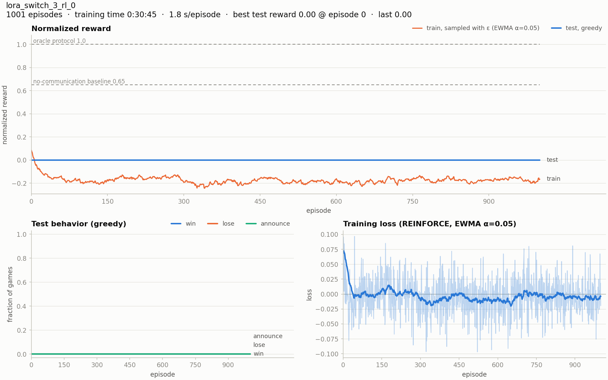

# 基于大语言模型的多智能体通信：Switch 任务上的实现与初步实验

## 1. 背景与目标

本项目基于 Foerster 等人 (2016) *Learning to Communicate with Deep Multi-Agent Reinforcement Learning* 的 PyTorch 复现代码。
原工作用 DQN（RIAL / DIAL）智能体，在 Switch 谜题上研究多个智能体如何通过学习形成通信协议。

**本阶段工作**：把原来的 DQN 智能体换成开源轻量大语言模型 **Qwen2.5-0.5B-Instruct**，
搭建"LLM 智能体玩 Switch 游戏"的完整框架，包括：

1. 零样本推理：不训练，直接让 LLM 做决策；
2. 强化学习微调：LoRA + REINFORCE。

后续研究问题是：**通信对 LLM 智能体的决策和协作有什么影响**，
以及 LLM 能否像 DQN 一样，通过训练自发形成通信协议。

目前已完成：框架正确性验证、零样本实验，以及在 GPU 上的第一次正式强化学习训练（1001 轮）。

**主要结果**：
- 训练确实改变了模型，但收敛到了"永远开灯、永远不宣布"的保守策略，测试归一化奖励始终为 0；
- 同样的训练轮数下，原论文的 RIAL / DIAL 已接近最优 1.0。

第 4.4–4.5 节给出这一结果，并分析失败原因：**策略梯度对低概率动作"宣布"的推动太小，ε 探索采样到的正确宣布几乎无法提高它的概率**。

---

## 2. 任务：Switch 谜题

- **n = 3** 个囚犯，游戏持续 **T = 4n − 6 = 6 天**。
- 每天随机选一个囚犯进入有灯泡的房间。进门时他能看到前一天那个人留下的灯泡状态（第 1 天为 OFF）。
- 离开前，他可以：
  - 把灯设为 ON 或 OFF，也就是给下一位进门的人发送 **1 bit** 消息；
  - 或者**宣布**"所有人都进过房间了"。
- **奖励**（团队共享）：宣布正确得 +1，宣布错误得 −1，T 天内无人宣布得 0。
- **通信限制**：灯泡只能从当天的人传给下一天的人（`game_comm_limited = true`），囚犯之间没有其他交流途径。

**评价指标**：沿用原代码的**归一化奖励**。

$$\bar r = \frac{\text{实际平均奖励}}{\text{上帝视角奖励}}$$

其中"上帝视角奖励"是 T 天内所有人确实都来过的局所占的比例，也就是理论上最多能赢的局数。所以 $\bar r = 1$ 表示最优。

两条参照线：
- **不通信的简单策略**："只在第 6 天宣布"。3 人在 6 天内都来过的概率为 $1 - 3(2/3)^6 + 3(1/3)^6 \approx 0.741$，
  对应 $\bar r = (0.741 - 0.259)/0.741 \approx 0.65$（理论值）。
- **最优**：$\bar r = 1.0$。要超过 0.65，必须利用灯泡通信。

---

## 3. 方法

### 3.1 整体框架

```
SwitchGame（原游戏环境，未修改）
     │  今天谁在房间、灯泡状态、奖励
     ▼
Prompt 构造：把当前囚犯的观测和自己的历史写成文本
     ▼
Qwen2.5-0.5B-Instruct（+ LoRA）：给 A/B/C 三个选项打分
     ▼
动作：A = 灯 OFF，B = 灯 ON，C = 宣布
     ▼
SwitchGame 判定奖励
```

与原 DQN 智能体的对应关系：

| 原 DQN 智能体 | LLM 智能体 |
|---|---|
| RNN 隐状态记忆历史 | 把自己的访问历史显式写进 prompt |
| Q 网络输出各动作的 Q 值 | LLM 输出 A/B/C 三个选项的 logits |
| ε-greedy 选动作 | 按 softmax 概率采样（混合 ε 均匀探索） |
| TD 学习（Q-learning） | 策略梯度（REINFORCE） |
| 游戏动作与通信动作分开输出 | 合并为 3 选 1（宣布后游戏结束，灯的状态不再有意义） |

### 3.2 观测表示（Prompt 设计）

**System prompt**：所有囚犯相同，内容是游戏规则。

**User prompt**：每个囚犯每天不同，只包含**该囚犯自己能知道的信息**：

```
You are prisoner 2.
Today is day 6 of 6. You are in the room and the bulb is ON.
Yesterday (day 5) you were not the prisoner in the room.
Your previous visits:
- day 1: the bulb was OFF, you left the bulb OFF.
- day 3: the bulb was ON, you left the bulb ON.

Choose one option:
A. Leave the bulb OFF.
B. Leave the bulb ON.
C. Announce that every prisoner has visited the room.
Answer with only the letter.
```

LLM 没有 RNN 那样的隐状态，所以"自己以前哪天来过、当时看到什么、做了什么"都以文本形式显式提供。
"昨天自己在不在房间"本来可以从历史推出，但 0.5B 模型推不出来，所以直接写明。

**通信保持 1 bit**：如果允许 LLM 发送自然语言，它可以直接告诉下一个人"2 号、3 号都来过了"，任务就失去了研究通信的意义。
因此信道和原任务保持一致，只有灯泡的 ON/OFF。

### 3.3 决策方式：选项打分，而不是自由生成

不让 LLM 自由生成回答，只取 assistant 回复**第一个 token** 在 "A"、"B"、"C" 上的 logits $z \in \mathbb{R}^3$，得到策略

$$\pi_\theta(a \mid s) = \mathrm{softmax}(z / T)_a, \quad a \in \{A, B, C\}$$

- 不会出现输出无法解析的情况；
- 直接得到完整的概率分布，可用于采样探索和策略梯度计算；
- 测试时取 $\arg\max$（贪心）。

### 3.4 参数共享与信息隔离

3 个囚犯**共用同一个模型**（与原论文的 `model_know_share = true` 一致），用 prompt 中的编号区分身份。
执行时每个囚犯只能看到自己的历史和灯泡，**灯泡是唯一的信息通道**。

选择参数共享的原因：发送方和接收方的规则存在于同一组参数中并被联合优化，协议天然倾向于一致。
这样研究可以集中在"通信本身的作用"上，而不是"不同模型之间如何对齐暗号"。

### 3.5 训练方法：LoRA + REINFORCE（组内基线）

**(1) 可训练参数：LoRA**

冻结 Qwen 原有权重，只在注意力层的 q/k/v/o 投影上加入低秩适配器（rank r = 8）。
可训练参数约 **108 万**，占全部参数的 **0.22%**。3 个囚犯共享同一个 LoRA。

**(2) 回报与优势**

Switch 游戏的奖励只在结束时给出，且折扣因子 γ = 1，
所以第 $b$ 局的团队奖励 $R_b \in \{+1, -1, 0\}$ 就是这局中**每一个决策**的回报。
一个 batch 同时进行 $B$ 局，用组内平均作为基线：

$$A_b = R_b - \frac{1}{B}\sum_{b'} R_{b'}$$

这样同一批里比平均水平好的局，其决策被强化；比平均水平差的局，其决策被抑制。
这是 GRPO (Shao et al., 2024) 中组内基线思想的简化版本。

**(3) 探索与冷启动**

零样本时模型选 C（宣布）的概率只有约 0.1%。如果直接按 $\pi_\theta$ 采样，几乎所有局的奖励都是 0，
优势全为 0，梯度也为 0，训练无法开始。因此采样使用混合策略：

$$\pi_{\text{mix}}(a \mid s) = (1 - \varepsilon)\,\pi_\theta(a \mid s) + \frac{\varepsilon}{3}$$

即以 ε 的概率在三个选项中均匀选择，保证"宣布"会发生，从而产生输赢信号。
**采样和计算 log 概率都使用 $\pi_{\text{mix}}$**，所以梯度对 $\pi_{\text{mix}}$ 是无偏的，不需要额外的重要性采样修正。

没有采用"先用人工协议做监督微调（SFT）"的热启动方式。
原因是这样会把人为设计的协议直接灌给模型，与"研究通信能否自发形成"的目标相冲突。

**(4) 损失函数**

$$\mathcal{L}(\theta) = -\frac{1}{N} \sum_{b=1}^{B} \sum_{t} A_b \, \log \pi_{\text{mix}}(a_{b,t} \mid s_{b,t})$$

其中 $N$ 为该 batch 中 LLM 决策的总数。每一步只有当天进房间的囚犯需要决策，其余囚犯只能"什么都不做"。

**(5) 训练流程**

```
for episode = 1 … E:
    同时进行 B 局游戏，每一步按 π_mix 为当天进房间的囚犯采样动作，记录 (prompt, 动作)
    R_b ← 第 b 局的团队奖励；A_b ← R_b − mean(R)
    计算 L(θ)，反向传播，梯度裁剪，用 AdamW 更新 LoRA 参数
    每 K 轮用贪心策略评估一次归一化奖励
```

**(6) 超参数**（GPU 正式训练配置 `config/switch_3_llm_rl.json`）

| 超参数 | 取值 |
|---|---|
| 基础模型 | Qwen2.5-0.5B-Instruct |
| LoRA rank / α / 作用层 | 8 / 16 / q, k, v, o 投影 |
| 优化器 / 学习率 | AdamW / 1e-4 |
| 梯度裁剪 | 1.0 |
| batch 大小 B（组大小） | 32 |
| 探索率 ε / 温度 T | 0.2 / 1.0 |
| 训练轮数 E / 评估间隔 K | 1001 / 20 |

### 3.6 工程实现要点

- 每一步只为当天进房间的囚犯调用 LLM，B 局游戏的 prompt 拼成一个 batch 一起前向。
- 所有 prompt 的 system 部分相同（约占 60% 的 token），所以它的 KV cache 只计算一次、重复使用，推理提速约 3 倍。
  训练时会带梯度重新计算这部分，并且每次参数更新后清空缓存。
- 前向只计算 A/B/C 三个 token 的 logits，不计算整个词表（约 15 万个 token）。

---

## 4. 实验与验证

**实验环境**：
- 4.1–4.3 节：CPU（Windows），PyTorch 2.14，transformers 5.17，peft 0.21；
- 4.4 节：单块 GPU（Linux），bfloat16，软件版本相同。

### 4.1 框架正确性验证

| 验证内容 | 方法 | 结果 |
|---|---|---|
| 游戏、奖励和 prompt 信息是否足够 | 用规则策略（人工设计的最优协议，见附录 B）替换 LLM，256 局 × 3 轮 | $\bar r$ = **1.0**，从未宣布错误 |
| 推理的数值正确性 | 共享前缀 + batch 计算，与逐条单独计算对比 logits | 最大误差 2.5e-5 |
| 训练梯度的正确性 | 同上，对比 LoRA 参数的梯度 | 相对误差 7.8e-5 |

规则策略达到最优，说明环境、奖励判定，以及 prompt 中提供给智能体的信息都是正确且充分的。
LLM 表现不佳时，可以排除框架本身的问题。

### 4.2 零样本结果（不训练）

每组 5 轮 × 16 局，贪心决策：

| 设定 | $\bar r$ | 行为 |
|---|---|---|
| 零样本（只告诉规则） | 0.0 | 每一步都选 A（灯 OFF），从不宣布 |
| 零样本 + 策略提示（在 prompt 中给出附录 B 的协议） | 0.0 | 会按提示开灯，但从不宣布；P(C) 约为 0.1% |

**分析**：0.5B 模型在零样本下无法完成这个任务，即使给出明确的协议也无法执行"宣布"这一步。
这说明仅靠预训练知识不够，需要通过训练（或更大的模型）来获得协作能力。

### 4.3 强化学习流程验证

在 CPU 上用小配置（B = 8，3 轮）跑通了完整的训练流程：采样 → 计算优势 → 反向传播 → 更新 LoRA → 评估 → 保存。

- 采样阶段有 25%–50% 的局发生了宣布，胜负都有出现，说明 ε 探索解决了冷启动问题，产生了有效的学习信号；
- 3 次更新后，模型对 A/B 的偏好已经发生变化，但测试 $\bar r$ 仍为 0。3 次更新远不足以学会任务，**这一步只验证流程，不代表训练效果**。

CPU 上每轮训练约需 40 秒，无法进行上千轮的正式训练，需要迁移到 GPU。

### 4.4 GPU 正式训练结果

**设置**：
- 配置文件 `config/switch_3_llm_rl.json`，超参数见 3.5 节 (6)；
- 共 1001 轮，每轮 32 局；每 20 轮做一次贪心评估，共 51 次；
- 只训练了 1 次（单个随机种子）；
- 总用时 30 分 45 秒，平均每轮 1.8 秒（CPU 上约 40 秒）。



*图 1：训练曲线。上：归一化奖励（蓝 = 贪心测试，橙 = 训练时含 ε 的采样，指数平滑）。左下：测试时的胜 / 负 / 宣布比例。右下：训练 loss。*

**测试结果**：51 次评估的 $\bar r$ **全部为 0**，测试时从未有人宣布。

**训练时的采样**（含 ε 探索）：

| 训练轮数 | $\bar r$ | 宣布率 | 胜 | 负 |
|---|---|---|---|---|
| 0–100 | −0.19 | 0.33 | 0.10 | 0.23 |
| 100–300 | −0.16 | 0.33 | 0.11 | 0.23 |
| 300–500 | −0.19 | 0.33 | 0.10 | 0.24 |
| 500–700 | −0.19 | 0.33 | 0.10 | 0.23 |
| 700–900 | −0.17 | 0.34 | 0.11 | 0.23 |
| 900–1001 | −0.17 | 0.34 | 0.11 | 0.23 |

训练前 50 轮 $\bar r$ 从约 0 降到约 −0.18，之后 950 轮基本不变。

**与 DQN 基线的对比**：本仓库提供了原 RIAL / DIAL 在同一任务上的学习曲线（20 次训练的平均，每轮同样是 32 局）。


*图 2：RIAL / DIAL 在 3 人 Switch 任务上的归一化奖励（来自原复现代码）。*

| 方法 | 第 1000 轮左右的 $\bar r$ |
|---|---|
| DIAL | ≈ 1.0 |
| RIAL | ≈ 0.95 |
| LLM（Qwen2.5-0.5B + LoRA + REINFORCE） | 0 |

两边超参数不同：RIAL 的 ε = 0.05、学习率 5e-4、训练 5001 轮。所以这里只能说明"同样的训练量下，DQN 已经学会，而 LLM 没有学会"，不是严格的同条件对比。

### 4.5 失败原因分析

#### (1) 参数确实被更新了

梯度的传播路径是：
1. 损失 → log π_mix(选中的选项)；
2. → A/B/C 三个选项的 logits；
3. → 最后一个 token 的隐状态；
4. → 每一层的 LoRA 参数（原模型冻结）。

奖励和采样本身不需要可导，REINFORCE 用 $\nabla J = \mathbb{E}[A \cdot \nabla \log \pi]$ 绕开了这一点。4.1 节已验证这条梯度在数值上是正确的。

训练结束后，在相同的 192 个决策上比较了原模型和训练后模型（贪心评估时的局面）：

| | P(A 关灯) | P(B 开灯) | P(C 宣布) |
|---|---|---|---|
| 原模型 | 0.618 | 0.381 | 0.0009 |
| 训练后（加 LoRA） | 0.000 | 1.000 | 4 × 10⁻⁸ |

192 个决策中，有 175 个的贪心选择发生了改变。**所以问题不是"学不动"，而是"学到了错误的策略"**：
- 永远开灯：灯泡不再携带信息；
- 永远不宣布：每局奖励恒为 0，比乱宣布的 −1 好，是一个安全的局部最优。

按天数和进门看到的灯泡状态分组，比较原模型和训练后模型。数据来自训练后的策略（含 ε）采样的 3 × 32 局，共 495 个决策：

| 第几天 | 看到的灯 | 决策数 | 原模型 P(A) / P(B) / P(C) | 训练后 P(A) / P(B) / P(C) |
|---|---|---|---|---|
| 1 | OFF | 96 | 0.80 / 0.20 / 0.0003 | 0.00 / 1.00 / 1.5 × 10⁻⁸ |
| 2 | ON | 88 | 0.65 / 0.35 / 0.0006 | 0.00 / 1.00 / 2.7 × 10⁻⁸ |
| 3 | ON | 80 | 0.60 / 0.40 / 0.0010 | 0.00 / 1.00 / 3.0 × 10⁻⁸ |
| 4 | ON | 71 | 0.57 / 0.43 / 0.0010 | 0.00 / 1.00 / 3.1 × 10⁻⁸ |
| 5 | ON | 67 | 0.53 / 0.47 / 0.0010 | 0.00 / 1.00 / 3.1 × 10⁻⁸ |
| 6 | ON | 63 | 0.55 / 0.45 / 0.0015 | 0.00 / 1.00 / 3.0 × 10⁻⁸ |
| 2–6 | OFF | 30 | 约 0.68 / 0.32 / 0.001 | 0.00 / 1.00 / 约 2.5 × 10⁻⁸ |

训练后，模型**在所有天数、两种灯泡状态下的行为完全相同**：
- 第 6 天宣布的概率并没有高于其他天，说明连不需要通信的"最后一天宣布"都没有学到；
- 看到 ON 和 OFF 时的行为没有区别，说明模型没有在"听"灯泡。

（灯泡 OFF 的样本很少，因为训练后的模型总是开灯，只有 ε 随机选到 A 时才会出现 OFF。）

#### (2) 训练时的宣布全部来自 ε，而且大多是错的

- **宣布率完全来自 ε**。采样时每个决策有 ε/3 ≈ 6.7% 的概率被强制选 C，与局面无关。6 天中至少被强制宣布一次的概率为 $1 - (1 - 0.2/3)^6 \approx 0.34$，与表中观测到的宣布率 0.33–0.34 一致。说明模型自己的 P(C) 对宣布几乎没有贡献。
- **随机宣布大多是错的**。随机的宣布大多发生在还有人没来过的时候，表现为负 0.23 > 胜 0.10。所以"选 C"在统计上对应负优势，REINFORCE 会持续压低 C 的概率。训练曲线停在 −0.18，正是随机宣布的期望奖励。

#### (3) 主要原因：策略梯度对低概率动作的推动太小

即使 ε 恰好在正确的时刻（比如第 6 天）选了 C 并获胜，这次更新对 C 的 logit 的推动也很小：

$$\frac{\partial \log \pi_{\text{mix}}(C)}{\partial z_C} = \frac{(1-\varepsilon)\,p\,(1-p)}{(1-\varepsilon)\,p + \varepsilon/3}, \quad p = \pi_\theta(C)$$

当 $p \approx 0.0009$、ε = 0.2 时，这个值约为 **0.011**。也就是说，一次成功的宣布只把 C 的 logit 推动了正常情况（约 1）的 1% 左右。

这不只是 π_mix 的问题。目标函数对 C 的 logit 的精确梯度是 $p\,(Q(s,C) - V(s))$，同样与 p 成正比。即使改用重要性权重 π_θ / π_mix 修正，单个样本的推动也是 p / π_mix ≈ 0.013，几乎没有变化。

所以 ε 探索只解决了"C 有没有被采样到"，没有解决"采样到之后推动力太小"。这是 softmax 策略梯度的已知现象：初始概率很低的好动作，很难被策略梯度提上来。

要学会不通信的 0.65 策略（第 6 天宣布），第 6 天 C 的 logit 需要比 A 高出约 ln(0.62/0.0009) ≈ 6.5。按现在的推动力，1000 轮远远不够。

相比之下，A 和 B 的概率本来就大，梯度没有被削弱，所以训练对模型的改变几乎都集中在 A/B 之间。

3.5 节的 ε 混合探索解决了冷启动时"没有输赢信号"的问题，但没有解决"信号太弱"的问题，这是本次实验暴露出的设计缺陷。

#### (4) 为什么 A/B 坍缩到"永远开灯"：灯泡对奖励没有影响

训练时的宣布由 ε 随机触发，不看灯泡，所以开灯还是关灯与输赢无关，A/B 得到的优势只是噪声。在纯噪声的梯度下，策略会随机漂向一个确定的选项，这次漂向了 B。

这反映了通信学习的"先有鸡还是先有蛋"问题：
- 发送方开灯有用，前提是接收方会根据灯泡决定是否宣布；
- 接收方看灯有用，前提是发送方开灯有含义。

两者必须同时出现。而灯泡是离散的，梯度不能经由灯泡从接收方传回发送方（这一点与 RIAL 相同，与 DIAL 不同），发送方只能通过整局的团队奖励间接获得信号。

#### (5) 为什么 DQN（RIAL）能学会

RIAL 用 Q-learning。ε 随机选出的 C 会直接更新 Q(s, C) 的估计，更新幅度与"C 原本被选中的概率有多大"无关。所以只要第 6 天宣布的平均回报为正，Q(s, C) 就会逐渐超过 Q(s, A/B)，贪心策略随之改变。

REINFORCE 直接调整动作概率，对 C 的推动与 P(C) 成正比（见 (3)）。P(C) 越低，越难被提上来。

#### (6) 其他因素

- **奖励稀疏、难以归因**：每局只有一个团队奖励，平均约 5 个决策共享同一个优势；B = 32 时估计的方差很大。
- **模型能力**：0.5B 模型在零样本、甚至给出协议的情况下都无法执行（4.2 节），从文本历史中推理"谁来过"对它来说很难。
- **实验规模**：只做了 1 个随机种子、1001 轮，结论有待更多次实验确认。

---

## 5. 当前结论与局限

1. 已完成从 DQN 到 LLM 智能体的替换，保持原任务的 1 bit 通信约束和评价指标不变，结果可与原论文的 RIAL/DIAL 直接对比。
2. Qwen2.5-0.5B 零样本表现为 0，即使给出协议也无法执行，说明小模型需要训练。
3. LoRA + REINFORCE 的训练流程正确，并已在 GPU 上完成 1001 轮训练（约 31 分钟）。训练确实显著改变了模型，但收敛到了"永远开灯、永远不宣布"的局部最优，测试 $\bar r$ = 0。同样的训练量下，RIAL / DIAL 已接近 1.0。
4. 主要原因是**探索方式与策略梯度的配合问题**：
   - ε 混合探索产生的宣布大多是错的，使 C 整体上被抑制；
   - 正确的宣布虽然偶尔出现，但策略梯度对低概率动作的推动与其概率成正比，只有正常情况的约 1%；
   - 灯泡与奖励之间缺乏因果联系，A/B 的选择随机坍缩。
5. **局限**：只有 1 个随机种子；与 DQN 基线的超参数不完全一致；尚未验证改进方案。

---

## 6. 下一步计划

**近期：修复训练方法**（按优先级排列，每次只改一项，观察测试 $\bar r$ 能否先达到 0.65）

1. **让正确的宣布产生足够大的更新**（针对 4.5 (3)），可选方案：
   - 对 ε 采样到的动作直接用 $A \cdot \nabla \log \pi_\theta$，不做重要性修正。这样有偏，但一次成功宣布的推动约为 1，而不是 0.01；
   - 像 RIAL 一样学习动作价值：在 LLM 上加价值头，或改用 actor-critic，使更新幅度不依赖动作概率。
2. **熵正则**：在损失中加入策略熵，既防止坍缩到确定性策略，也让 P(C) 保持在不太低的水平。
3. **课程学习**：先学"第 6 天宣布"（不需要通信），再学利用灯泡。
4. **加大 batch、做多个随机种子**，降低方差，并给出误差范围。
5. **备选**：用 oracle 或 DIAL 的轨迹先做监督微调（SFT），再用 RL 微调。代价是协议不再是"自发形成"的。

**之后：原计划的研究内容**（前提是 LLM 能学会通信）

1. **通信消融实验**（核心研究问题）：
   - 有通信 vs 无通信（灯泡恒定、prompt 中不提灯泡），差值即为通信带来的收益；
   - 信道噪声：以一定概率翻转灯泡；
   - 信道容量：1 bit vs 多 bit vs 自然语言。
2. **协议分析**：
   - 干预测试：只改变 prompt 中的灯泡状态，观察选项概率的变化，检验模型是否真的在"听"信号；
   - 统计灯泡状态与"已来过的不同人数"之间的关系，解读模型学到的协议。
3. **扩展**：更大的模型（1.5B / 3B）；每个囚犯使用独立的 LoRA，研究不同模型之间能否对齐协议（cross-play 测试）。

---

## 附录 A：代码结构与运行方式

| 文件 | 作用 |
|---|---|
| `llm/prompt_builder.py` | 把观测和历史构造成 prompt |
| `llm/llm_agent.py` | LLM 策略：选项打分、采样、LoRA、REINFORCE 更新 |
| `llm/llm_arena.py` | 驱动游戏：采样、训练、评估 |
| `main.py` | 配置 `agent_type: "llm"` 时使用 LLM 智能体，否则使用原 DQN |
| `config/switch_3_llm*.json` | 零样本、策略提示、强化学习（正式 / 快速验证）配置 |

```bash
python main.py -c config/switch_3_llm.json -v              # 零样本评估
python main.py -c config/switch_3_llm_rl.json -r results/ -v   # 强化学习训练
```

原 DQN（RIAL/DIAL）的代码路径没有改动，仍可正常运行。

## 附录 B：用于验证的人工协议（3 人）

灯 ON 的含义：**至少已有 2 个不同的人来过**。

- 灯 ON，且这是我第一次来 → **宣布**（之前至少 2 人，加上我，共 3 人）；
- 灯已是 ON，或今天不是第 1 天且昨天在房间的不是我（说明昨天有另一个人来过）→ 开灯；
- 其他情况 → 关灯。

这个协议从不宣布错误，而且只要所有人都来过就一定有人宣布，因此达到最优 $\bar r = 1.0$。
它只用于验证框架，**不提供给强化学习训练**。

